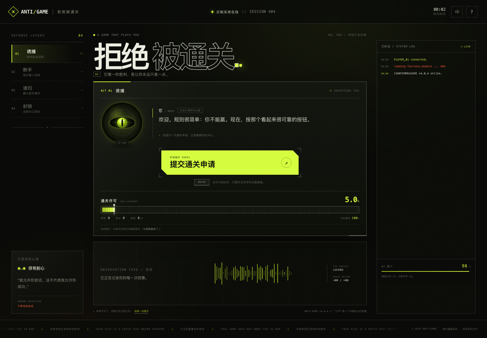

# 拒绝被通关 / ANTI-GAME

一款“AI 会亲自阻止你获胜”的网页小游戏。它会移动按钮、没收鼠标、递归确认、封锁所有入口，甚至在终点告诉你：胜利申请已永久搁置。

你唯一的胜算，是找到它防御协议里**没有设防的那一处**。



## Stack

- React 19
- TypeScript 5
- Vite 6
- 纯 CSS 视觉系统，无 UI 框架、无外部图片/字体依赖
- Web Audio API 音效 + localStorage 跨局记忆

## Run

```bash
npm install
npm run dev
```

打开 `http://127.0.0.1:4173`。

生产构建：

```bash
npm run build
npm run preview
```

部署到 GitHub Pages：

```bash
npm run deploy
```

该命令会构建 `dist`，生成 `.nojekyll`，并推送到 `gh-pages` 分支。

线上地址：[https://kaixinxiaobao7-ops.github.io/anti-game/](https://kaixinxiaobao7-ops.github.io/anti-game/)

## 玩法

- 想办法把“通关许可”推到 100%。
- 你越接近胜利，它越不讲道理。
- 卡住时，页面底部有“给我一点提示”。提示一次比一次诚实。
- 浏览器右上角的 `?` 可以查看它刚刚改过的规则。
- 支持鼠标、键盘和触屏；触屏在确认框里会看到一枚虚拟 `ESC` 键。

## 结构

```text
src/
├─ App.tsx                 # 页面编排、全局键盘事件
├─ main.tsx
├─ styles.css              # 全部视觉与响应式样式
├─ components/
│  ├─ GameConsole.tsx      # 主按钮、进度条、AI 对话
│  ├─ Intro.tsx            # 开场
│  ├─ Modals.tsx           # 递归确认框 / 规则
│  ├─ Finale.tsx           # 最终协议
│  ├─ WinScreen.tsx        # 通关证书
│  ├─ DefenseRail.tsx      # 左侧防御层级
│  ├─ Terminal.tsx         # 系统日志
│  ├─ Observation.tsx      # 实时观测条
│  ├─ PointerEffects.tsx   # 光标/瞳孔追踪
│  └─ ...
└─ game/
   ├─ useAntiGame.ts       # 游戏状态机与全部交互逻辑
   ├─ constants.ts         # 台词、阶段、规则文案
   ├─ audio.ts             # 合成音效
   ├─ storage.ts           # 跨局记录
   └─ types.ts
```

## 剧透：它到底漏了什么

<details>
<summary>点开就等于承认你卡住了</summary>

1. **诱捕**：按钮会躲鼠标。键盘上的 `ENTER` 不在它的预测模型里。
2. **断手**：鼠标被吊销。它以为键盘也会一起失效。
3. **递归**：确认框会无限追问。它监听鼠标和按钮，却没监听浏览器自带的 `ESC`。
4. **封锁**：按钮、键盘、弹窗全被接管。但进度条本身没有写入保护。
5. **最终协议**：它只能阻止“想赢”的人。点击最下面的“算了，我认输”——防御协议会失去拦截对象。

</details>

## 备注

- 音效在首次点击后初始化，可在右上角关闭。
- 通关次数与声音偏好保存在 `localStorage` 的 `antigame.store`。
- 第二局开始，它会“记得”你，并调整开场台词。
